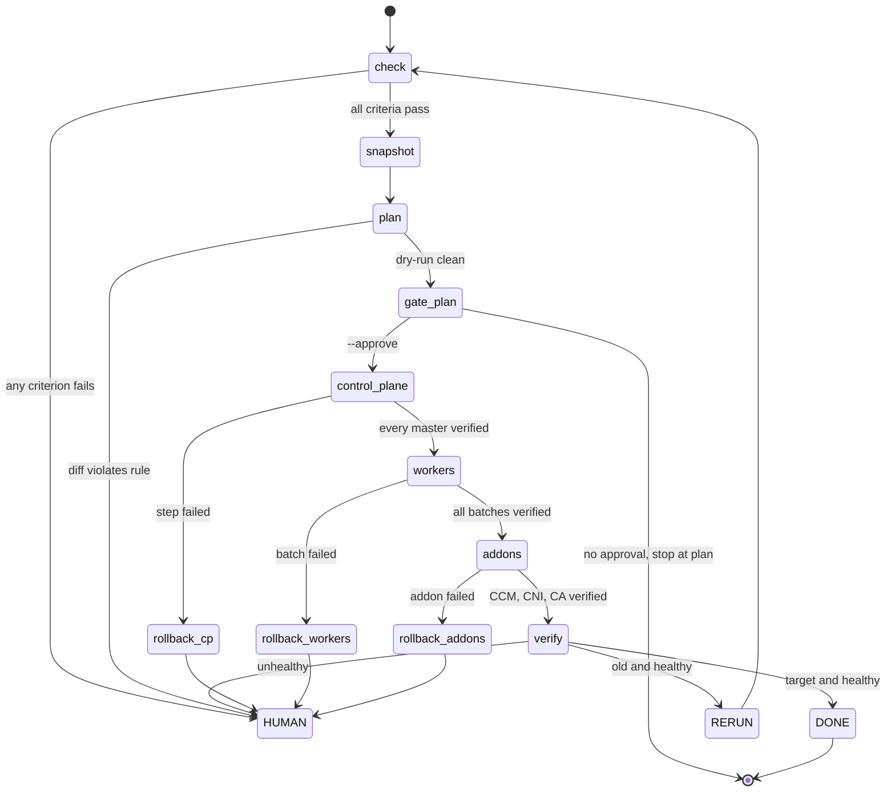

# Method: the upgrade safety system as states and gates

The problem was never "manual or automated". It was that at any step nobody could answer: **what evidence says it is safe to do the next thing?** The system answers that by making every transition a gate with a written criterion, and every gate leaves evidence.

This document is the model. The simulator in `upgrade_safety/` executes exactly this and nothing else; a gate that is not here does not exist in code.

> **Provenance.** This repository is a clean-room re-implementation of my own 2026 design notes on upgrade engineering. It contains no employer code, schemas or names; the contracts, the engine and the fleet are written from scratch here.

## 0. The loop: desired, observed, diff, steps

Every action in an upgrade answers one question: **if this goes wrong, how far does it spread and how long does it take to come back?** The system asks it the same way every time, as a level-triggered reconcile:

```
desired (target minor, target AMI, pointers aligned)   vs   observed (a snapshot)   ->   diff   ->   steps
```

Nothing remembers "what we already did"; each step re-reads the world and asserts a difference exists before it acts (`precheck`), acts once, then asserts the difference was consumed without new breakage (`postcheck` against the baseline). A step whose difference is already gone is skipped (`already_done`), which is what makes interruption and resume safe, and lets a human-watched run and an unattended run share one loop.

What looks like a special case (an ASG whose launch template, ASG pointer and running nodes disagree) is not a trap. It is drift: a difference between desired and observed, shown in the diff before anything runs.

### Control plane and execution plane

| | Control plane (decides) | Execution plane (acts) |
|---|---|---|
| Does | interprets steps, evaluates probes over snapshots, runs gates, writes evidence, owns order and state | `observe()` a snapshot; `execute()` one already-decided, idempotent action |
| Never | touches the cluster | decides what runs next, retries, skips, judges health |
| Here | `engine.py`, `reconcile.py`, `probes.py`, `gate.py` | `executors.py` (`SimulatedExecutor`) |

The seam is the `Executor` interface. Adapters for Terraform (declarative infrastructure: launch template and AMI pointers), Ansible (ordered imperative actions: kubeadm, drain) and direct cloud API calls are registered by name and refuse loudly (`NotImplementedError`). They are not implemented; the simulator is the only executor shipped. The `engine` field on each step names the real tool class the action belongs to.

### Four contracts between layers

Layers pass data, not references to each other's internals. The contracts are JSON Schemas in `upgrade_safety/contracts/`, and every artifact a run writes is validated against them in tests.

| Contract | Produced by | Read by | Notes |
|---|---|---|---|
| `snapshot` | `observe()` | probes, check, verify, plan | role is `baseline`, `precheck`, `postcheck` or `daily`; a baseline and a postcheck form a delta pair |
| `diff` | `plan` | the gate | `reversible`, per-change `reversible`, pointer `alignment`, `verdict.safe_to_apply` for machine gates |
| `step` | `steps.py` | the reconcile loop | `layer`, `reversible`, `backup_precondition` (required when irreversible), `blast_radius`, `precheck`, `execute`, `postcheck`, `gate` |
| `evidence` | the reconcile loop | humans, audits | one append-only line per attempt in `evidence.jsonl`; outcome is one of `converged_skipped`, `applied_pass`, `stopped_precheck`, `stopped_postcheck`, `rolled_back`, `halted_by_operator` |

### Reversibility is declared, and enforced

Each step says whether it can be undone by re-pointing (`reversible: true`: launch template, ASG instance refresh, addon rollout) or only by restoring a backup (`reversible: false`: in-place control-plane upgrade). An irreversible step **refuses to execute** unless its `backup_precondition` holds (`etcd-snapshot-fresh`: a snapshot exists and is within 1000 raft entries of the live cluster). The mandatory "snapshot first" rule is one instance of this general rule, not a special case: the control-plane component steps are the irreversible ones, and the snapshot step is what satisfies their precondition.

### Two orthogonal axes of blast radius

- **Layer** (dependency, serial): `master` -> `worker` -> `components`. A later layer never starts before the earlier is verified.
- **Tier** (how much at once, inside the worker layer): a **canary** of exactly one node, then **batches** of at most 20%, stateful nodes alone and first. Tiers answer "how many at a time"; layers answer "what first".

## 1. Pipeline



Every failure ends at a human. The system never decides to retry a layer on its own and never forces anything (no forced drain, no `--force`). Rollback is *advice with pre-declared triggers*, executed by a person.

### Step table

| # | Step | Gate (what must be true to leave it) | On failure |
|---|---|---|---|
| 1 | `check` | all criteria in section 2 pass, and agree with the external monitor | stop, human |
| 2 | `snapshot` | etcd snapshot written to evidence before any mutation | stop |
| 3 | `plan` | the **diff artifact**: desired versus observed, per-change reversibility, pointer alignment, quorum-math blast radius, verdict; kubeadm dry-run clean; worker AMI kubelet = target; Launch Template differs only in AMI | stop, human |
| 4 | `gate:plan` | human approval (`--approve`) after reading the diff | stop at plan, exit 2 |
| 5 | control plane, per master | gate (sign-off) -> apiserver -> `/readyz` + LB membership -> controller-manager -> scheduler -> kubelet -> etcd member back, lag <= 1000, node Ready | stop layer, human, rollback advice |
| 6 | workers | Launch Template AMI-only update; then canary (one node), then ASG instance refresh batches of at most 20% (stateful nodes alone, first); each: drain without force, replace, nodes Ready | stop on first failed step |
| 7 | components (addons) | CCM -> CNI -> Cluster Autoscaler, each with its own verification, each requires the previous | stop layer |
| 8 | `verify` | full check re-run, diff against baseline file, version x health quadrant | human unless quadrant is "proceed" |

## 2. `check`: the baseline made explicit

Fail conditions are fixed, not judged on the day.

| Criterion | Pass when | Why this form |
|---|---|---|
| etcd members | odd count, every member online | even or partial membership changes quorum arithmetic |
| raft index lag | every follower within **1000** entries of the leader | quorum can exist on paper while replication is unhealthy; a lagging follower is the first thing to break during a leader transfer |
| leader | exactly one | zero or two means election trouble |
| nodes | every node Ready | |
| kube-system | every pod Running; CCM, CNI, Cluster Autoscaler healthy | the addons are what the upgrade will touch last, so they must be healthy first |
| external alerts | zero active | a cluster that is already on fire is not upgraded |
| monitor cross-check | the independent monitor agrees on node and etcd member counts | defends against "the baseline itself is wrong" |
| etcd snapshot | taken, recorded in evidence, before anything mutates | the only way back for the control plane |

The check cross-validates itself against external monitoring because a check built from the same API it is judging can be wrong in the same way the cluster is.

## 3. `plan`: a dry-run that can fail

- **Control plane**: `kubeadm upgrade plan` plus a configuration dry-run diff. The simulator checks the hop is exactly one minor (kubeadm cannot skip) and the version-skew arithmetic holds after each component moves.
- **Workers**: AMI diff. The target AMI's kubelet must equal the target version. Launch Template diff: only the AMI id may change; any other changed field fails the plan.
- **Blast radius by quorum math.** `tolerated = (members - 1) // 2`. Three masters tolerate one. With `serial: 1` only one master is ever being changed, so the worst case is one node, equal to the tolerated number. The plan prints both numbers and fails if `serial > tolerated`. Workers: worst case is the batch size (20% of the group, rounded up; stateful nodes go alone).

## 4. `apply`: three layers, each with a gate

### 4.1 Control plane: in place, one master at a time, a signature per master

For each master, in order:

1. **gate**: human sign-off for this master (logged individually).
2. **apiserver**.
3. **apiserver gate**: `/readyz` passes **and** the master is a healthy member of the load balancer.
4. controller-manager.
5. scheduler.
6. kubelet.
7. verify: etcd member back online, raft lag <= 1000, node Ready.

Only then the next master.

#### The apiserver is the gate

Version skew is anchored on the apiserver: kubelet may trail it by up to **2** minors, controller-manager and scheduler by up to **1**, and none may be newer. So the apiserver goes first on each master, and nothing else on that master moves until the apiserver has proven itself twice:

- `/readyz` says it is serving (not just that the process exists);
- the load balancer counts it as a healthy member (otherwise "upgraded" means "removed from service", and with `serial: 1` the next master is then the only one left).

Failing either stops the layer with controller-manager, scheduler and kubelet untouched, so the master is in a known, recoverable, half-upgraded state: new apiserver, old everything else, which the skew rules allow. The simulator enforces both checks and has a test that the next component's version does not change when `/readyz` fails.

#### Leader transfer is expected

Upgrading the master that holds the etcd leadership moves leadership (a 1-2 second election). That is normal and logged as expected. **A member that does not come back is the danger**, and it is exactly what step 7 and the snapshot gate frame.

### 4.2 Workers: immutable replacement

New AMI, Launch Template updated (AMI only), ASG instance refresh in **20%** batches, pause on failure. Nodes hosting databases are mapped beforehand and go first, one at a time (batches smaller than 20%, never larger). Drain never forces: a PDB that allows zero disruptions blocks the drain, and the procedure is wait-for-PDB or an explicit human decision to lower `minAvailable`. Drain timeout is 300 s by default; a cluster known to evict slowly carries a per-cluster flag of 600 s.

Tiers: step `workers:canary` replaces exactly one node (the first stateful node if any); `workers:batch<N>` follow, each at most 20% of the group. On a dark (traffic-shifted) cluster the 20% batch is a *pacing* mechanism, small enough to pause fast, rather than user protection.

### 4.3 Addons: dependency order

| Order | Addon | Verification | Why here |
|---|---|---|---|
| 1 | cloud-controller-manager | rollout healthy | an unhealthy CCM leaves new workers stuck on the `uninitialized` taint |
| 2 | CNI (`maxUnavailable: 1`) | cross-node pod connectivity | scale-out and rescheduling need the network |
| 3 | Cluster Autoscaler | drain one node, observe a successful scale-out | its verification needs nodes that can initialise (CCM) and networking (CNI) |

Each step requires the previous to be completed (a precheck on `addon.at_target` of the previous addon); a failing CCM rollout stops the layer with CNI and Cluster Autoscaler untouched, and the reason is written into the run.

## 5. `verify`: version x health

Two questions, answered from data:

| | healthy | unhealthy |
|---|---|---|
| **target version** (every component) | **proceed** | human |
| **old / mixed version** | **re-run** (idempotent steps) | human |

- Health = the section 2 criteria re-run, plus no regression against the baseline (new alerts, fewer Ready nodes, lower Running-pod ratio).
- The comparison is against the **baseline file written before the upgrade**, never against anyone's memory.
- The check is cross-validated against external monitoring.
- "Zero incidents" is only meaningful against this pre-agreed standard.

## 6. Rollback: per layer, triggers declared in advance

Triggers (any one): a master upgrade step fails; more than **50%** of pods not Running; a critical service unreachable; an alert flood (five or more new alerts versus baseline).

| Layer | Action | Note |
|---|---|---|
| Control plane (`master`) | restore the etcd snapshot **and** downgrade binaries | the snapshot restores data, not binaries; both are needed |
| Workers (`worker`) | stop the instance refresh, revert the Launch Template to the previous AMI | instances already replaced stay until a human decides |
| Addons (`components`) | `kubectl rollout undo` for the failed addon | |

The simulator writes `rollback.json` with the fired triggers and the action for the failed layer. It does not execute it. A failure that fires no trigger (for example a PDB blocking a drain) is not a rollback: the cluster is in a known state and a person fixes the cause.

## 7. Fleet policy

Order: **dev -> preprod -> prod canary -> remaining prod -> management cluster last** (highest blast radius). Any failure pauses the whole fleet until a human approves continuation; the system does not skip the failed cluster and carry on.

## 8. The hard parts, as method entries

1. **API deprecation is its own workstream.** Removals ship per minor; the canonical case is PodSecurityPolicy removed in 1.25. Scan and migrate workloads before the hop; roll out Pod Security Admission in `warn`/`audit` first and enforce only after zero violations; keep infrastructure namespaces explicitly privileged, because logging and monitoring DaemonSets legitimately need it. Control-plane-first ordering is safe by construction because of the skew policy.
2. **Stateful nodes first, PDBs never forced.** Map database-hosting nodes ahead (Kafka, MySQL, YugabyteDB, ClickHouse are the cases), put them first in each wave, one at a time, verify the service before the next. A PDB violation on a dark cluster cannot hurt users but still blocks drain, so: wait or lower `minAvailable` explicitly, never force. PDB covers voluntary disruption, HPA load, readiness probes rollouts; hardware failure and application bugs are not covered and are handled by multi-AZ placement.
3. **Heterogeneity.** Fifty clusters drift. Classify by `cluster_type` (workload / management / dev-staging) and express residual exceptions as per-cluster feature flags (for example `drain_timeout_s: 600`). Drift is not eliminated; it becomes visible in the check baseline. A growing flag count means the classification is wrong.
4. **"Zero incidents" is a claim against a standard.** Define the standard first: the quadrant, the baseline diff, the external cross-check, business-layer correctness and not only infrastructure health.
5. **Leader transfer vs. member loss.** The first is routine, the second is the danger. The gates are built around the second.
